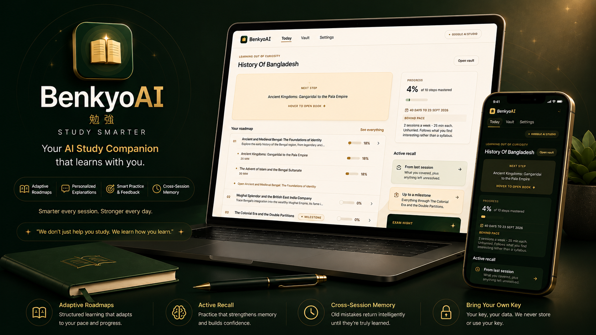

# BenkyoAI

**勉強** · *benkyō* — the Japanese word for *study*.

Your personal AI study companion. Local-first, private, and built around one idea: **active learning sticks**. You bring your own AI provider key — your usage, your cost, your control.



---

## ✨ Features

**🧠 Bring Your Own Key (BYOK)** — No accounts, no sign-ups. Connect your own AI provider key (Google Gemini, OpenAI, or Anthropic) with a guided step-by-step setup. Your key stays in your browser, and you're in control.

**🗺️ Adaptive Roadmaps** — Tell BenkyoAI what you want to learn (and why — exam, project, job, or curiosity), and it generates a structured learning tree: Roadmap → Topics → Subtopics. Adjust the depth, set a deadline, and the roadmap adapts around your pace.

**📝 Active Practice** — Each subtopic comes with MCQ and short-answer practice. Mistakes are categorized (misunderstanding, careless, or missing concept) so you know exactly what to work on. At key checkpoints, "explain back" prompts ask you to teach the concept in your own words.

**🔄 Active Recall** — Two modes keep your knowledge fresh: **session-wise** recall (what you just studied) and **milestone-wise** recall (everything up to a checkpoint). **Exam Night Revision** is a dedicated high-focus mode that runs recall across your entire vault.

**📚 Multi-Vault Library** — Organize your materials into separate vaults. Each vault holds its own roadmaps, topics, subtopics, practice history, and sessions — everything neatly nested under one roof.

**💡 Memory Across Sessions** — End-of-session summaries track what you covered, what you struggled with, and what you understood well. The next session opens by referencing the last one. Growth callouts celebrate when you get something right that you used to struggle with — weak points blend into new lessons rather than living in a separate review tab.

**📄 Material Parsers** — Paste text, upload PDFs or PPTX slides, or drop a YouTube link. BenkyoAI extracts the content so the AI can work with it.

---

## 🧰 Tech Stack

| | |
|---|---|
| **Framework** | [Next.js 16](https://nextjs.org/) (App Router) |
| **UI** | [React 19](https://react.dev/) + [Tailwind CSS v4](https://tailwindcss.com/) |
| **Language** | [TypeScript](https://www.typescriptlang.org/) |
| **State** | [Zustand](https://github.com/pmndrs/zustand) |
| **AI SDK** | [Google Gen AI](https://github.com/googleapis/js-genai) (`@google/genai`) |
| **Storage** | localStorage + Origin Private File System (OPFS) |
| **Parsing** | PDF.js, pptx-parser, youtube-transcript |

---

## 🚀 Getting Started

### Prerequisites

- **Node.js 20+**
- An API key from one of the supported providers (you'll set this up in the app)

### Install & run

```bash
git clone https://github.com/Muhimen123/BenkyoAI.git
cd BenkyoAI
npm install
npm run dev
```

Open [http://localhost:3000](http://localhost:3000) — the onboarding flow will walk you through connecting your API key and starting your first study session.

### Development fallback

For local development, you can set a `GEMINI_API_KEY` in `.env.local`. The app will use this as a fallback when no user key is present — but the product is designed around BYOK; the env var is a convenience for contributors, not the real key model.

---

## 📖 How It Works

1. **Connect your key** — The first time you open the app, you're guided through getting and entering an API key from Google, OpenAI, or Anthropic. Validated inline, stored locally.
2. **Create a vault** — Each vault is a container for a subject or project. Give it a name and start adding materials.
3. **Build a roadmap** — Tell BenkyoAI what you want to learn, optionally upload materials, answer a few calibration questions, and set your purpose and deadline. The AI generates a structured learning roadmap.
4. **Study & practice** — Work through topics and subtopics. Each step includes an explanation and practice questions. Answer wrong? The app tells you *why* and adapts.
5. **Active recall** — Regularly test your memory with session-wise, milestone-wise, or vault-wide recall sessions. Exam Night Revision gives you a focused, high-intensity review mode.
6. **Session memory** — Finish a session, get a summary. Come back later and the app remembers where you were, what you struggled with, and celebrates your growth.

---

## 📁 Project Structure

```
src/
├── app/                     # Next.js App Router pages
│   ├── page.tsx             # Onboarding flow
│   ├── dashboard/           # Main dashboard
│   ├── vault/               # Vault library
│   ├── roadmap/             # Roadmap detail view
│   ├── subtopic/            # Subtopic practice & explanations
│   ├── session/             # Study session views
│   ├── recall/              # Active recall sessions
│   ├── settings/            # Key management & preferences
│   └── api/                 # API routes (Gemini proxy)
├── components/
│   ├── ui/                  # Primitives (Button, Card, Badge, etc.)
│   ├── byok/                # BYOK key setup & validation
│   ├── onboarding/          # Onboarding steps & loaders
│   ├── practice/            # Question cards, explain-back, results
│   ├── recall/              # Recall item cards
│   └── shell/               # App shell, header, wordmark
├── lib/
│   ├── api/                 # Client-side API wrappers
│   ├── parsers/             # PDF, PPTX, YouTube, text parsers
│   ├── types.ts             # Shared TypeScript types
│   ├── vault.ts             # OPFS-based vault persistence
│   └── utils.ts             # Utility functions
└── store/
    ├── useStudyStore.ts     # Active study session state
    └── useVaultStore.ts     # Vault state & persistence
```

---

## 🏗 Architecture

**Local-first.** Everything lives in your browser — your API key, your materials, your roadmaps, your progress. There are no user accounts, no servers storing your data, and no backend databases. The Origin Private File System (OPFS) handles file storage; localStorage handles settings and state.

**BYOK data flow.** When you practice or generate a roadmap, your API key is sent directly from the browser to the Next.js API routes, which proxy the request to your chosen AI provider. The key is never stored anywhere except your browser.

```
Browser (Zustand + localStorage)
  │
  ├── Onboarding → API key validated inline
  ├── Study flow → calls /api/* routes
  │                    │
  │                    ▼
  │               Next.js API route
  │                    │
  │                    ▼
  │               Gemini / OpenAI / Anthropic
  │
  └── Vault → OPFS (files) + localStorage (metadata)
```

---

## ⚙️ Development

```bash
npm run dev      # Start development server
npm run build    # Production build
npm start        # Start production server
npm run lint     # Run ESLint
npm test         # Unit tests (diagnosis, FSRS, retrieval, schemas, providers) + MCP end-to-end test
```

This project uses [Next.js 16's built-in MCP](https://nextjs.org/docs) at `/_next/mcp` for runtime diagnostics during development.

Full technical documentation lives at [`/docs`](https://benkyoai.vercel.app/docs).

## 🔌 BenkyoAI MCP server

Study from Claude Desktop, Claude Code, Cursor or any MCP client. In the app, go to **Settings → Export my vault** (the file never contains your API key), then add:

```json
{
  "mcpServers": {
    "benkyoai": {
      "command": "node",
      "args": ["/path/to/BenkyoAI/mcp/server.mjs", "/path/to/benkyoai-vault.json"]
    }
  }
}
```

Tools: `list_roadmaps`, `get_roadmap`, `get_weak_points`, `get_due_reviews`, `get_session_history`, `get_study_plan`, `get_usage`. Prompts: `quiz_me`, `explain_back`. Read-only, stdio only. Try it with the bundled sample: `npm run mcp -- mcp/sample-vault.json`.

---
